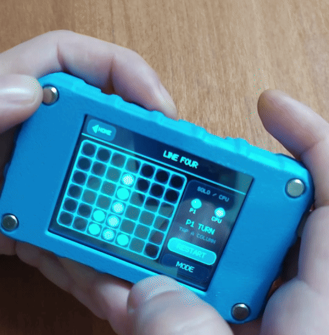
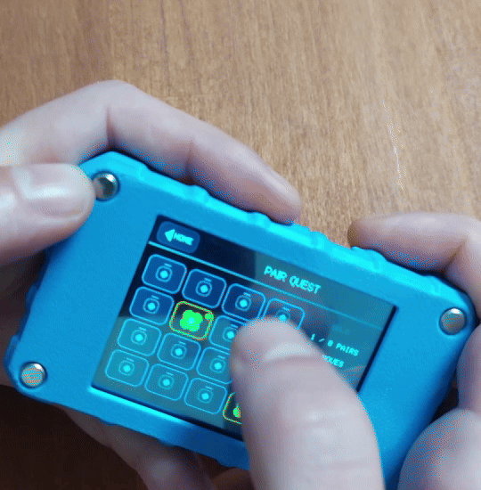
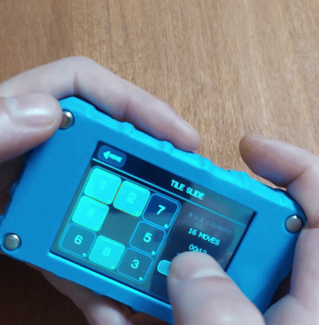

# CrowPanel Pocket Arcade

**Six original touchscreen games on one tiny offline ESP32 arcade.**

[**View the project and install firmware in your browser**](https://pocket-arcade.lepczynski.it/) · [YouTube](https://www.youtube.com/watch?v=BkuglAy6qOQ) · [Blog](https://lepczynski.it/) · [All links](https://links.lepczynski.it/) · [More projects](https://github.com/lepczynski-cloud)

[](CHANGELOG.md) [](LICENSE)

<p align="center">
  
</p>
<p align="center"><sub>The three newest games filmed on the real device. The gallery below shows all six.</sub></p>

CrowPanel Pocket Arcade runs on the **Elecrow CrowPanel 2.8-inch ESP32**. It needs no Wi-Fi, Bluetooth, account, SD card or background service during play. Connect the device, choose a game and use the touchscreen.

## The six games

| Real device | Game and gameplay |
| --- | --- |
|  | **Burst Hunt**<br>Tap safe targets, avoid the red X and build a combo before the timer ends. Easy, Normal and Hard modes change the pace and pressure. |
|  | **Shift Vault**<br>Swipe pieces across a generated 6×6 board and guide the golden key through the exit. Every board is created from legal reversible moves. |
|  | **Star Pod Sprint**<br>Tap to jump over geometric obstacles, collect coins and keep the pod moving. Choose from three speed modes. |
|  | **Line Four**<br>Drop cyan and pink discs into seven columns and connect four. Play against the local CPU or share the device with a second player. |
|  | **Pair Quest**<br>Flip 16 cards and match eight procedural symbols. Finish quickly in solo mode or compete for the most pairs in local two-player mode. |
|  | **Tile Slide**<br>Move numbered tiles into the empty space and restore the sequence. Choose a solvable 3×3 or 4×4 board. |

The first three images are unchanged project photos. The last three are simple crops taken directly from the uploaded GIF. No perspective correction, generated screen, overlay or colour adjustment was applied. The GIF itself was optimised losslessly without changing its dimensions, frame order, timing or rendered pixels.

## Launcher and v1.4 improvements

All six games are available from the same **320×240 touch launcher**. The card highlight advances every **750 ms**, making the animation calmer and easier to follow.

Firmware v1.4 also includes:

- targeted updates in Line Four, Pair Quest and Tile Slide, removing the flashing right-side panel;
- a `6 GAMES | OFFLINE` footer without the old `1-2 PLAYERS` label;
- a touchable `lepczynski.it` label in the lower-right corner;
- an offline About screen with **Small screens. Big ideas.** and a QR code for [links.lepczynski.it](https://links.lepczynski.it/).

## Install from the browser

Open **[pocket-arcade.lepczynski.it](https://pocket-arcade.lepczynski.it/)** in desktop Chrome or Edge over HTTPS.

1. Connect the CrowPanel using a data-capable USB cable.
2. Choose **Install / recover** for a first installation or clean recovery.
3. Select the correct serial port and follow the browser prompt.
4. Press RESET after flashing if the game does not start automatically.

If the board does not enter download mode, hold **BOOT**, briefly press **RESET**, then release BOOT.

> [!IMPORTANT]
> The installer is intended only for the **Elecrow CrowPanel 2.8-inch ESP32-WROOM-32-N4 with a 320×240 ILI9341-compatible display**. It is not compatible with the CrowPanel 1.28-inch ESP32-S3 Rotary Buddy, M5Stack devices or other display variants.

The page also provides **Update firmware**, which writes only the application at `0x10000`. Use it only when the device already has the same `huge_app.csv` partition layout.

<details>
<summary><strong>Hardware and PlatformIO details</strong></summary>

| Detail | Value |
| --- | --- |
| Device | Elecrow CrowPanel 2.8-inch ESP32 |
| Microcontroller | ESP32-WROOM-32-N4, 4 MB flash |
| Display | 320×240 landscape, ILI9341-compatible TFT |
| Touch | XPT2046-compatible resistive touch |
| Firmware | Arduino C++, PlatformIO, TFT_eSPI 2.5.31 |
| Partitions | `huge_app.csv` |
| TFT MISO / MOSI / SCLK | GPIO 4 / 13 / 14 |
| TFT CS / DC / backlight | GPIO 15 / 2 / 27 |
| Touch CS | GPIO 33 |

Build and upload with PlatformIO:

```bash
python3 -m pip install --user --upgrade platformio
pio run -e crowpanel_28
pio run -e crowpanel_28 --target upload
pio device monitor --baud 115200
```

For manual touch calibration, set `RUN_TOUCH_CALIBRATION = true` in `include/AppConfig.h`, upload the firmware and copy the five values printed over serial into `src/AppConfig.cpp`.

</details>

<details>
<summary><strong>Repository layout</strong></summary>

- `src/`, `include/`, `platformio.ini`: firmware and game code.
- `include/AboutQr.h`: fixed QR matrix for `https://links.lepczynski.it/`.
- `web/index.html`, `web/_headers`: responsive project website and hosting headers.
- `web/assets/`: the original project photos, latest gameplay GIF, direct frame crops and QR image.
- `scripts/build_pages.sh`: firmware build and ESP Web Tools manifest generation.
- `CHANGELOG.md`, `LICENSE`, `NOTICE`, `SECURITY.md`: release history and project policies.

</details>

The source, game names, procedural art, game logic and generated puzzles belong to this project. Line Four uses generic four-in-a-row rules with original code and visuals. Pair Quest uses original procedural symbols. Tile Slide uses the traditional numbered-tile mechanic with independently generated solvable scrambles. Commercial game assets are not included.

**License:** [MIT](LICENSE). Created by [Wojciech Lepczyński](https://lepczynski.it/).
