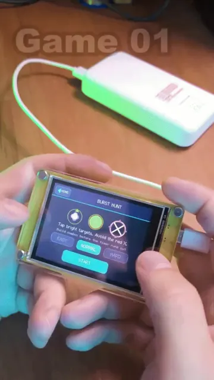
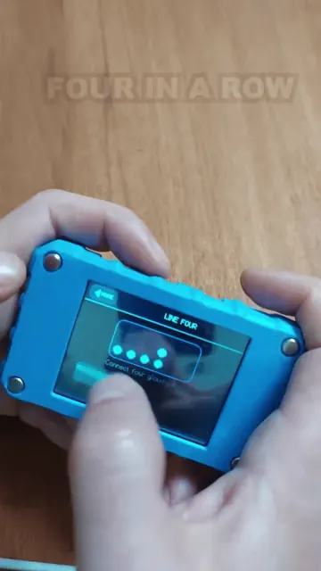
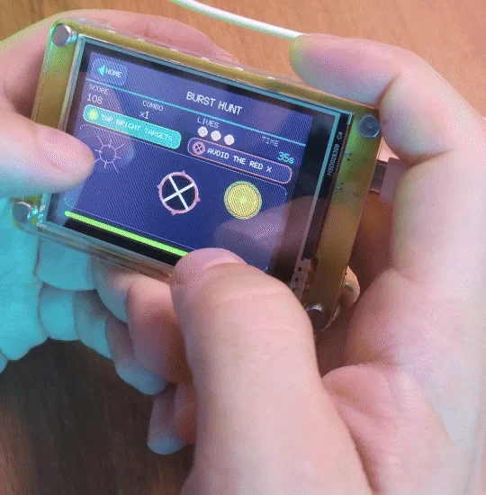
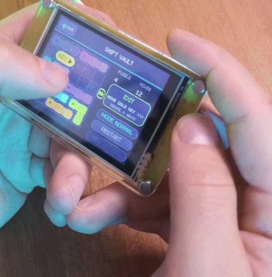
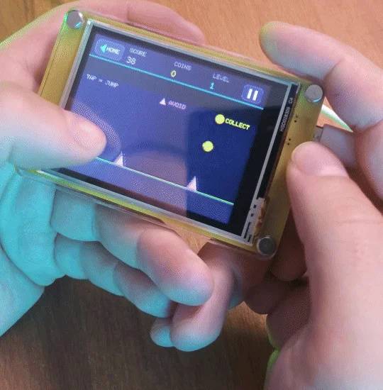
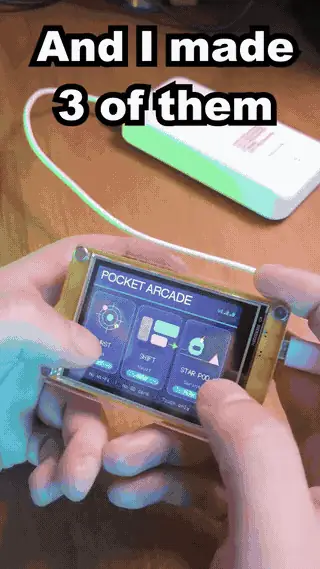

# CrowPanel Pocket Arcade

**Six original touchscreen games. One tiny offline ESP32 arcade.**

[**See the games and install firmware from your browser**](https://pocket-arcade.lepczynski.it/) · [YouTube](https://www.youtube.com/watch?v=BkuglAy6qOQ) · [Blog](https://lepczynski.it/) · [All links](https://links.lepczynski.it/) · [More projects](https://github.com/lepczynski-cloud)

[](CHANGELOG.md) [](LICENSE)

<p align="center"></p>

The Elecrow **CrowPanel 2.8-inch ESP32** runs six games, an animated touch-first launcher and original procedural graphics. No Wi-Fi, Bluetooth, PSRAM, SD card, downloaded game assets, account or background service is required to play.

Firmware v1.4 adds a built-in About screen, a QR code linking to the creator's GitHub, YouTube, blog and LinkedIn, smoother launcher timing and flicker-free status panels in the three newest games.

## The six games

| Game | How to play |
| --- | --- |
| **Burst Hunt** | Tap safe targets, avoid mines and build combos. Easy, Normal and Hard. |
| **Shift Vault** | Swipe pieces in four directions to guide the golden key to the exit. Generated 6×6 puzzles. |
| **Star Pod Sprint** | Tap to jump over geometric obstacles, collect coins and survive. Three speed modes. |
| **Line Four** | Drop cyan and pink discs into seven columns. Get four in a row to win. **Solo vs local CPU** or **two players on one device**. The CPU tries to win, blocks immediate threats and considers the next move. |
| **Pair Quest** | Flip 16 cards to match eight procedural symbols. **Solo:** finish in fewer tries and less time. **Two players:** take turns, earn a point for each match and keep your turn when you find one. |
| **Tile Slide** | Tap numbered tiles next to the empty space to put them in order. Choose a **3×3** or **4×4** board. Scrambles are generated through legal moves, so each puzzle is solvable. |

All six games are accessible directly on the **same 320×240 launcher screen**. The launcher staggers card appearances and now advances its subtle highlight every 750 ms. `HOME` returns to the launcher. The footer shows `6 GAMES | OFFLINE` and a touch target labelled `lepczynski.it`.

Tapping that label opens a local About screen with the message **Small screens. Big ideas.**, a short introduction and a QR code pointing to [links.lepczynski.it](https://links.lepczynski.it/). The screen remains fully usable offline. Only scanning the QR code requires a connected phone.

## Current recording previews

| Complete six-game lineup | Line Four, Pair Quest and Tile Slide |
| --- | --- |
|  |  |

The previews above were optimised for the project page and README. They show the real device, not rendered mockups.

### Actual-device photos of the original games

| Burst Hunt | Shift Vault | Star Pod Sprint |
| --- | --- | --- |
|  |  |  |

### Earlier animated gameplay

| First recorded build | Three-game v1.2 build |
| --- | --- |
|  |  |

The legacy animations were converted from GIF to animated WebP to reduce repository and page weight while retaining the motion. [Watch the original gameplay video on YouTube](https://www.youtube.com/watch?v=BkuglAy6qOQ).

## Flicker-free status panels

Line Four, Pair Quest and Tile Slide no longer repaint the complete right-hand panel whenever a value changes. Static borders, labels and buttons are drawn once. Only the affected turn label, score, move counter, timer or status line is updated afterward. This removes the visible right-side flash during gameplay and one-second timer updates.

## Install directly from your browser

Open **https://pocket-arcade.lepczynski.it/** in desktop **Chrome or Edge**, using HTTPS. Connect the device with a **data-capable USB cable** and follow the installer's serial-port prompt. If your board does not enter download mode automatically, hold **BOOT**, briefly press **RESET**, then release BOOT. Press RESET after flashing if the game does not start automatically.

The page has two installation choices:

- **Install / recover:** a complete factory image starting at `0x0`, including the ESP32 bootloader (`0x1000`), partition table (`0x8000`), OTA initialisation (`0xe000`) and application (`0x10000`). Recommended for first installation and recovery.
- **Update firmware:** application only at `0x10000`. Use only if the existing device has the **same `huge_app.csv` partition scheme**. Avoid choosing *Erase device* if you want to preserve any other flash contents.

**Important:** The installer is specifically for the **Elecrow CrowPanel 2.8-inch ESP32-WROOM-32-N4 (320×240, ILI9341)**. It is **not** compatible with the CrowPanel 1.28-inch ESP32-S3 Rotary Buddy, M5Stack or other ESP32 display variants. ESP Web Tools detects the ESP32 chip family, not the attached panel model or wiring. Flashing a different board can overwrite its current firmware. Review the selected USB port before flashing.

Installation requires an ESP Web Tools-compatible Web Serial browser and a local USB connection. Normal gameplay does not require internet access. The browser flasher uses [ESP Web Tools](https://esphome.github.io/esp-web-tools/).

## Hardware and PlatformIO

| Detail | Value |
| --- | --- |
| Device | Elecrow CrowPanel 2.8-inch ESP32 |
| Microcontroller | ESP32-WROOM-32-N4, 4 MB flash |
| Display | 320×240 landscape, ILI9341-compatible TFT |
| Touch | XPT2046-compatible resistive touch |
| Firmware | Arduino C++, PlatformIO, TFT_eSPI 2.5.31 |
| Partitions | `huge_app.csv` |
| TFT MISO / MOSI / SCLK | GPIO 4 / 13 / 14 |
| TFT CS / DC / backlight | GPIO 15 / 2 / 27 |
| Touch CS | GPIO 33 |

You can still build and upload directly with PlatformIO:

```bash
python3 -m pip install --user --upgrade platformio
pio run -e crowpanel_28
pio run -e crowpanel_28 --target upload
pio device monitor --baud 115200
```

For manual touch calibration, set `RUN_TOUCH_CALIBRATION = true` in `include/AppConfig.h`, upload the firmware and copy the five calibration values printed over serial into `src/AppConfig.cpp`. The supplied defaults are calibrated for the original test device and may differ on another unit.

## Project files

- `src/`, `include/`, `platformio.ini`: device code and firmware configuration.
- `include/AboutQr.h`: compact fixed QR matrix for `https://links.lepczynski.it/`.
- `web/index.html`, `web/_headers`: responsive project website and hosting headers.
- `web/assets/`: optimised current previews, animated legacy gameplay, game photos and the browser-visible QR code.
- `scripts/build_pages.sh`: firmware compilation, verified images and ESP Web Tools manifests.
- `CHANGELOG.md`, `LICENSE`, `NOTICE`, `SECURITY.md`: release history, rights and security information.

The source, six original game names, procedural game art, game logic and generated puzzles belong to this project. Line Four implements generic four-in-a-row rules using original code and art. Pair Quest uses original symbols, not a commercial card deck. Tile Slide uses the traditional numbered-tile puzzle mechanic with independently generated scrambles. Commercial game assets are not included. `Elecrow` and `CrowPanel` identify supported third-party hardware, not an endorsement or affiliation. See [NOTICE](NOTICE).

**License:** [MIT](LICENSE). Created by [Wojciech Lepczyński](https://lepczynski.it/).
